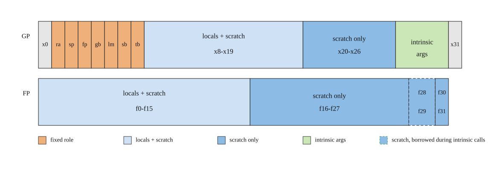
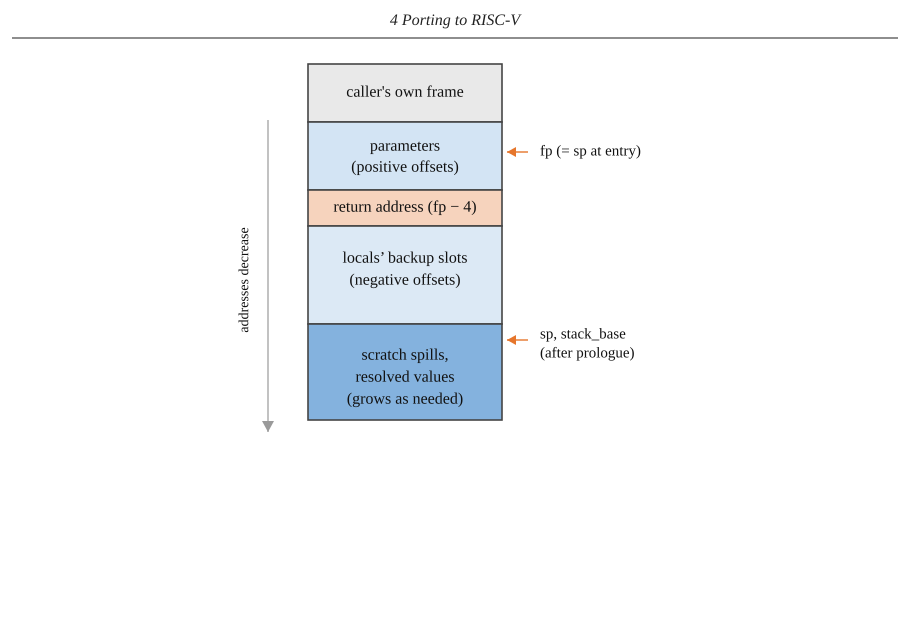

# 4 Porting to RISC-V

<!-- source-pdf-page: 29 -->

## 4.1 Register Allocation

### 4.1.1 Registers and Types

Unlike TriCore, RISC-V makes no distinction between registers used for addresses and those
used for data, as discussed in Chapter 2, though it does still separate general-purpose registers
from floating-point ones. We use the same general-purpose registers for both WASM locals
and the intermediate results of valent-block resolution, with a fixed partition deciding what
each register is used for.

Each WASM value type maps onto a specific kind of register. An i32 occupies a single
general-purpose register, while an i64 needs two, since RV32I has no 64-bit general-purpose
register (Chapter 2). These two registers are tracked as a single value rather than two
independent ones, and although nothing architecturally requires them to be adjacent, we
always allocate them that way. TriCore’s own extended registers go further, requiring the
lower half to sit in a specifically even-numbered register and the higher half in the following
odd-numbered one, a parity constraint we don’t apply here: any two adjacent registers will
do. An f32 or an f64 each occupies a single floating-point register on its own, with no pairing
needed, since the D extension widens the same registers to 64 bits rather than combining two
of them.

### 4.1.2 Reserved Registers

We do not follow the standard RISC-V calling convention: nothing at the instruction set
level forces any register into a particular role, so we are free to follow or depart from it
register by register. However, we keep the return address in x1 (numbering starts there since
x0 is already hardwired to zero by the ISA itself, as discussed in Chapter 2) and the stack
pointer in x2, their conventional positions. Changing them would still work but make the
resulting assembly harder to read and debug with standard tooling. None of the other usual
argument or callee-saved register roles are used, but five more registers have fixed roles of
our own instead: a frame pointer (x3), a base address for WASM’s globals (x4), one for linear
memory (x5), one for tables (x7), and a stack base (x6), ket at the bottom of the stack the way
an address register would hold any other fixed address. Having this many single-purpose
address registers is a legacy of TriCore’s own structure, where address registers were a
separate register file from data registers, as discussed in Chapter 2, so dedicating one to each
fixed address didn’t cost anything against the budget available for actual computation. On
RISC-V’s unified register file that is no longer true: these compete with locals and scratch for

<!-- source-pdf-page: 30 -->

the same pool. The stack base’s own current use is narrow: it only helps recover the frame
pointer after a call (described in Section 4.2). One of these choices is deliberate: the frame
pointer is x3, not the conventional x8. Some of the C extension’s compact instructions can only
address registers x8 through x15, as discussed in Chapter 2, so reserving x8 for the frame
pointer would have put one of those eight permanently out of reach. Using x3 keeps all eight
free and lets us use compressed instructions more often.

One further register is carved out for a purpose unrelated to the compiled function itself:
x31 saves the runtime’s own stack pointer around the one call that is not WASM-to-WASM,
the entry into compiled code, so that it can be restored once the compiled function returns
(described in Section 4.2).

### 4.1.3 Intrinsic-Call Registers

Four more registers serve mainly as arguments for a small number of WASM operations
with no direct RISC-V translation: float rounding (ceil, floor, trunc, nearest), conversions
between i64 and floating-point types, f32/f64 min/max, and the more complex i64 arithmetic
RV32I has no short instruction sequence for, division, remainder, shifts, and rotates. They
are also reused as general scratch for a few other things, among them call_indirect’s type
check and memory.grow.

Calling one of these intrinsics follows a fixed sequence. We move up to two integer
arguments into the four registers. A floating-point operand instead goes into one of two
dedicated floating-point argument registers, since Zcmp cannot protect floating-point registers
the way it protects general-purpose ones. Any pending floating-point scratch value the call
would otherwise clobber is relocated out of the way first, before anything else happens.
We then use Zcmp’s cm.push to save the return address and all twelve callee-saved general-purpose registers in a single compressed instruction, call a small hand-written intrinsic, and
use cm.pop to restore them once it returns. Being hand-written rather than compiled is what
makes this safe: each intrinsic only ever touches its own argument registers and whatever
Zcmp already saved, a guarantee that would not hold for an arbitrary compiled function with
no fixed bound on what it might clobber.

This is a maintainability compromise: it works, but the fixed argument registers, the
separate floating-point side channel, and the explicit save and restore are all things we have
to get right by hand. TriCore made this far simpler. Its SVLCX and RSLCX instructions save and
restore a whole lower context, several address and data registers plus the return address, in a
single instruction each, with no register list to choose and no separate mechanism needed
for a different register class. Its upper context is saved and restored automatically on every
call and return, with no instruction at all. Routing an operation with no direct translation
through a call like this is standard practice, not something specific to this port: GCC and
LLVM do the same wherever a target lacks hardware support for a given operation. What
differs from TriCore is the mechanism used to protect registers around such a call: RISC-V
has nothing resembling hardware-assisted context switching, as established in Chapter 2, so
we have to do by hand what TriCore did in hardware.

<!-- source-pdf-page: 31 -->

### 4.1.4 Parameters and Locals

When a function is called, its parameters are passed onto the stack by the caller, itself just
another function compiled the same way. So when the function begins, a parameter is already
on the stack at a positive offset from the frame pointer. The frame pointer is set equal to the
stack pointer at function entry, so everything the caller already pushed ends up on the positive
side, while everything the function itself owns gets a negative offset instead (described in
Section 4.2). We load a parameter into a register when one is available, from a budget of
twelve general-purpose registers, x8 through x19, and sixteen of the 32 floating-point registers,
f0 through f15. Declared locals draw from this exact same pool: parameters are allocated
first, in declaration order, and locals continue claiming whatever is left once every parameter
has had its turn. These two budget sizes were settled on empirically rather than derived:
which one performs best is workload-dependent, with no single value optimal across every
benchmark, but twelve and sixteen were found to be a good compromise across the ones
tested. A parameter that does not fit this budget simply stays at its original stack position,
loaded from there whenever an operation needs its value, the same treatment a register-less
local gets.

A declared local is different: every one gets a backup slot on the frame, at a negative
offset from the frame pointer, whether or not it also gets a register. Locals continue claiming
registers in declaration order from where the parameters left off, the first one declared gets
the next available register, and so on until the shared budget runs out. If a register is still
available, that register is initialized to zero and the backup slot is left uninitialized. If none is
available, the local is written directly to the backup slot instead, initialized to zero there. That
backup slot exists for one reason: a call is the only point where a local’s value actually needs
saving. We do not follow RISC-V’s own callee-saved convention, so a callee is free to reuse
any register however it likes.

### 4.1.5 Scratch Allocation and Spilling

Resolving a valent-block needs registers too, for the intermediate results described above.
General-purpose scratch draws from a wider range than parameters and locals do: any of
x8 through x26, both whatever is left over from their pool, x8 through x19, and the seven
registers beyond it, x20 through x26, that a parameter or a local never permanently claims.
A register-less parameter or local can still pass through one of those seven briefly when an
operation needs to load it, the same as any other scratch value, but it never keeps the register
once that operation is done. Floating-point scratch can use the full f0 through f31, not just
the sixteen the local pool is capped at. Unlike a parameter’s or a local’s register, none of
this is assigned permanently: a scratch register is handed out for as long as one pending
value needs it, then returned to the pool once that value is resolved. Because parameters and
locals get a smaller budget than either range provides, a function still leaves registers free
for resolution even once every parameter and local has claimed one, x20 through x26 on the
general-purpose side always among them regardless of how many parameters or locals a
function has. When none are free, we spill the oldest pending scratch value to the runtime

<!-- source-pdf-page: 32 -->

stack, in the order it was pushed, preserving WASM’s own stack ordering as described above.
Locals are never spilled this way.

Before falling back to a fresh scratch register at all, we first check whether the value being
resolved already has a known final destination, a local it is being written to, or a target
requested by whatever triggered its resolution. When that destination is a register and
nothing else already needs it at that same moment, we generate code directly into it instead
of a scratch register, avoiding the extra move a fresh register would otherwise cost. This is the
concrete form the destination-awareness described in Section 3.1.3 takes with valent-blocks:
knowing in advance where a result belongs lets us write directly there instead of computing
into scratch and moving it afterward.

What gets spilled is decided by how long a value has been pending, not by what type it
is. Every live scratch value is tracked in a single list in the order it was created, oldest first.
When the allocator cannot find a free register of the kind it needs, it walks that list from the
oldest entry onward and spills the first one still holding a register, whatever type it happens
to be, then checks again whether a suitable register has opened up. If the value it just spilled
was the wrong type, it walks the same list again from the front, skipping past anything
already on the stack, and spills the next oldest register-residing entry instead. This repeats
until a register of the needed kind is free. Freeing a general-purpose register by spilling an
older floating-point value first does not directly help the request that triggered it, but the age
ordering still has to be respected regardless of type, for reasons explained in Section 4.3. A
register pair spills as the single unit it represents, both halves written to two adjacent stack
words in one step, never split between two positions in that order.

This is also why locals never take part in that spilling mechanism at all. A local can be
read or written at any point, in any order, not just the most recently pushed one, so saving it
on that same age-ordered stack would break the very ordering the mechanism depends on.
A local’s backup slot on the frame is addressed directly, which is what makes that random
access safe.

Two more mechanisms protect a register from this whole allocate-and-spill process, independent of age or destination. They differ in how the protection is enforced. The first comes
up when resolving a store to memory: the value to be written is resolved into a register first,
then that register is locked, a single piece of state every allocation call checks automatically no
matter how deep the call chain gets, for as long as it takes to resolve the store’s own address,
itself a full nested computation that may need scratch registers of its own. The lock is always
set and cleared within that same function, never left in place once the address is resolved.
The second mechanism works differently: rather than a lock the allocator checks on its own,
it is an explicit list of already-claimed locations that whoever needs the protection must pass
along. It comes up whenever several registers must not collide with each other, for instance
an i64 comparison needing several temporaries at once, or when a destination must avoid
an operand already sitting in a register. That same list also has to be forwarded into any
nested resolution where the protection still applies, for instance resolving one operand of
a comparison while making sure the other, already computed, is left untouched. Nothing
about it is automatic: it only protects whatever has actually been passed to it.

<!-- source-pdf-page: 33 -->

Figure 4.1 summarizes the whole partition.

_Figure 4.1: Partition of the general-purpose (x0-x31) and floating-point (f0-f31) register files._

## 4.2 Calling Convention

### 4.2.1 Function Prologue and Return

As mentioned above, when a function is called, its parameters are passed from the top of
the WASM stack, with as many values as the callee’s own type declares. Every function
establishes its own frame the same way at entry, before any of its own body is compiled
and regardless of who calls it. The frame pointer is set equal to the stack pointer first, and
since the stack pointer at that point still points to the top of what the caller just pushed, this
single instruction is why parameters land at positive offsets from the frame pointer while
everything the function owns lands at negative ones, described in Section 4.1. The return
address is saved immediately afterward, one word directly below the frame pointer, before
anything else happens. It already sits in its conventional register at this point, placed there
by the caller’s own JAL, RISC-V’s jump-and-link instruction, which writes the address of
the following instruction into whichever register it names. However the first nested call this
function makes would overwrite that register with a new return address of its own, so the
original has to be moved to memory before that can happen.

Parameters and locals are set up next, the same allocation and initialization already
described in Section 4.1. Once every local’s slot has been accounted for, both the stack pointer
and the stack base are updated to point to the end of the frame, which is also the beginning
of the stack. Figure 4.2 shows the resulting layout.

_Figure 4.2: A function's frame at entry._

<!-- source-pdf-page: 34 -->

Returning undoes this the same way for every function, whether by an explicit return
or by falling off the function’s own natural end. The return value is resolved first, into its
conventional register, described below. The return address is then reloaded from that same
fixed offset below the frame pointer, using the frame pointer specifically rather than the stack
pointer. The stack pointer may have drifted during the function’s own body without the
physical register having been kept exactly in sync, described in Section 4.3, while the frame
pointer never moves once set. The stack pointer is then set back to the frame pointer directly,
undoing the single instruction the prologue opened with, before the function actually jumps
back to its caller.

This restoration is deliberate and explicit, which is why the stack pointer can always be
trusted immediately after any call returns. The frame pointer and stack base carry no such
guarantee: a callee restores only the stack pointer, and nothing else.

### 4.2.2 Making a Call

Before emitting a call, every pending valent-block is already resolved, the same behavior
already established for entering or leaving a block and for branches in general. This means
no scratch register ever needs saving around a call: by the time the call instruction is reached,
nothing is left pending in one.

Locals are a different matter. We do not follow RISC-V’s own callee-saved convention
(Section 4.1), so a callee is free to reuse any register however it likes, ours included. Before
a call, every register-homed local is written to its backup slot, and its tracked location is
remapped to point there instead of the register: a parameter to its original position on the
caller’s stack, a declared local to its dedicated backup slot, both described in Section 4.1. Any
code compiled after the call reads locals from this remapped state, which is why the WASM
value itself stays correct even though the callee may have overwritten the register it used to
live in.

TriCore made this far simpler. Its SVLCX and RSLCX instructions save and restore a whole
lower context, address registers A[2] through A[7], data registers D[0] through D[7], and
the return address, to a hardware-managed save area in a single instruction each. Its upper
context is saved and restored automatically on every call and return, with no instruction
needed at all. RISC-V has nothing resembling either mechanism, no hardware-assisted context
switching whatsoever, as established in Chapter 2. This is why we have to move each local to
its backup slot individually rather than saving everything at once with a single instruction.

Parameters for the call itself need no separate setup step: since everything is already

<!-- source-pdf-page: 35 -->

resolved by this point, pushing each argument onto the actual stack falls directly out of that
same resolution rather than needing an ABI of its own, landing exactly where the callee will
expect it, as described in Section 4.1.

### 4.2.3 The Call Instruction

The call itself is a single JAL, with the return address landing in x1, the same register the
standard RISC-V convention would use for it, another place we follow the usual choice even
though nothing obliges us to. Since this is a whole-module compiler and functions are not
necessarily translated in the order they call each other, a callee’s own address is not always
known yet at the point a call to it is compiled. If it is, the displacement is computed and
patched into the JAL immediately. If not, a placeholder JAL with a zero displacement is
emitted instead, and the call site is recorded for a later fixup pass, run once every function
has been translated and every address is known. This is the same placeholder-and-fixup idea
already used for forward branches within a single function, described in Section 3.2.2, just
operating across the whole module instead of within one function’s own body.

### 4.2.4 Indirect Calls

call_indirect is WASM’s mechanism for dynamic dispatch. Instead of naming the callee
by a fixed function index the way call does, it looks the callee up at runtime, through one
of the module’s own tables of function references, at a position given by a dynamic index
on the stack, as discussed in Chapter 2. For us, that means the target is never an address
we can know or fix up at compile time, only something we look up as the call happens.
WebAssembly 1.0 also permits at most one table per module, as noted there too, so there is
never any ambiguity about which table an indirect call means. The instruction’s own table
index is simply ignored.

The instruction’s dynamic index sits on top of the stack, above the call’s actual arguments.
It has to be set aside before those arguments are resolved onto the runtime stack the usual
way, then brought back and resolved into a register once that is done, otherwise it would be
swept up as if it were one of the arguments itself.

Before jumping anywhere, we check that the callee actually has the type the instruction
expects. Two different type indices can still describe the same signature if they were declared
separately but happen to be identical, so comparing indices directly would reject calls that
should be allowed. To avoid that, we compute a canonical id for every declared type once,
when the module’s types are first parsed: the lowest type index sharing that exact signature,
so any two equivalent types end up with the same id. What the instruction itself requires is
looked up in that table at compile time, at no runtime cost. What the callee actually is can
only be known at runtime, so its declared type index is loaded from the table, canonicalized
the same way, and compared against the static id, with a mismatch causing a trap.

Only once that check passes do we compute the callee’s address, TABLE_BASE plus four
times the index, load it from there, and jump to it. Everything after that, cleaning up the
arguments and capturing the result, is identical to an ordinary call, described above.

<!-- source-pdf-page: 36 -->

### 4.2.5 Returning from a Call

Once the callee returns, the arguments are gone as far as the caller’s own bookkeeping is
concerned: both the compile-time value stack and the modeled stack height are truncated by
however many bytes they occupied, and translation simply continues from there.

The result comes back in its conventional register: x10 for an i32, the pair x10 and x11 for
an i64, or f10 for a float, whatever those registers were holding inside the callee’s own body
by that point no longer matters. Arguments still go on the stack as described above, only
the result takes the conventional register. It is captured out of that register immediately: the
newly resolved value is written onto the runtime stack as the result of the call instruction
itself, the same as any other resolved value, rather than kept resident in a register.

Only two things need rebuilding after that: the stack base and the frame pointer. The
callee’s own return sequence, described above, restores only the stack pointer before jumping
back, so the caller rebuilds the other two itself. We recompute the stack base from the current
stack pointer, adjusted by however much of the stack was in use at this specific call site, then
derive the frame pointer from that using the same fixed offset established at entry. Every
local is then reloaded from its backup slot, undoing the remap performed before the call.

### 4.2.6 Entering from the Runtime

This whole chain, the call instruction, the argument and result registers, the frame set up at
entry and torn down at return, describes a call between two functions compiled the same
way. However, there is one place compiled code is entered differently: the very first call, from
the runtime itself into the first compiled function.

That entry point still follows most of what is described above. Arguments are copied
onto the stack in the same position an ordinary caller would leave them, and the result is
read back out of x10, x11, and f10 the same way. The difference is what sits on the other
side of the calling convention, not the convention itself: this is the one place our compiled
code is reached from plain Rust, compiled by LLVM to the standard RISC-V ABI, a different
convention from the one described throughout this chapter, and the two have to be reconciled
by hand at exactly this boundary.

Two kinds of register need protecting there, for two different reasons. Standard RISC-V
ABI marks s0 and s1, x8 and x9, as callee-saved, and the Rust code around this boundary
relies on that, but those two registers are ordinary members of our own scratch and local
pool, described in Section 4.1, and compiled WASM code is free to leave anything in them.
Others, the frame pointer and the base address for WASM’s globals among them, are fixed
roles of our own that happen to occupy registers the standard ABI reserves for something
else entirely. Either way, the runtime’s own inline assembly saves each one by hand before
handing control to compiled code and restores it again once compiled code returns, then
tells the surrounding Rust code explicitly that every other register our own convention might
touch should be treated as clobbered. Neither of these precautions are needed elsewhere:
everywhere else, both sides of a call were compiled by us, following the same convention, so
there is nothing left to reconcile.

<!-- source-pdf-page: 37 -->

x31 exists for a related but separate reason: the runtime’s own stack pointer, not the
compiled function’s. Before jumping into compiled code, the runtime’s own inline assembly
does preliminary work on the stack itself, saving the registers just described and allocating
space to copy the WASM arguments into, so by the time compiled code’s own prologue runs,
the stack pointer it inherits already reflects all of that. Compiled code’s own return sequence,
described above, only restores the stack pointer back to that inherited value, since it has no
way of knowing what the runtime did before it was ever entered. The runtime saves its own
original stack pointer in x31 before any of that preliminary work begins, then restores it from
there directly once compiled code returns, undoing its whole setup in one step rather than
reversing each part of it individually.

## 4.3 Stack Management

### 4.3.1 Two Heights

Generated code needs to know at every point where the runtime stack currently stands,
so that resolved values and spilled scratch registers land in the right place. Keeping track
of that needs more care on RISC-V than it did on TriCore. TriCore could simply keep its
own stack pointer exactly correct at every instant, as established in Chapter 1. Its load and
store instructions support post-increment and pre-decrement addressing, so the base register
adjusts automatically as a side effect of the access itself, meaning that pushing or popping
a value from the stack pointer costs nothing beyond the one instruction doing the actual
store or load. RISC-V has neither, as discussed in Chapter 2, so keeping the stack pointer
exactly right would mean a separate adjustment instruction around every push and pop.
We avoid that cost by not insisting on exactness in the first place, and track two separate
notions of the runtime stack’s height instead. One, the modeled height, is the true amount
of stack space genuinely in use at any point, updated immediately whenever something is
pushed, popped, or spilled there, whether a spilled scratch value or a resolved value pushed
to preserve WASM’s own stack ordering, as described in Section 4.1. The other is wherever
the physical stack pointer register has actually been set to. Only the register is allowed to lag
behind the true height, since we would rather not pay the cost of an additional instruction to
adjust it every time,

### 4.3.2 Ordering and Spilling

This single, monotonically tracked height is also why every push onto this stack, whether a
resolved value taking its place there or a spilled scratch register, has to happen in a specific
order. A location on this stack is just a distance from wherever the current top happens to be,
not an independent address the way a general-purpose allocator would hand out, so a value
can only be reclaimed once everything pushed after it has already been reclaimed. When the
entire stack is resolved at once, described in Section 3.1.3, each pending value is walked in the
same order WebAssembly itself would have pushed it, from the bottom of the compile-time
stack upward, and given a height strictly larger than whatever came before it. That is what

<!-- source-pdf-page: 38 -->

makes the physical stack a faithful mirror of WebAssembly’s own: what is logically deeper
always ends up at a smaller height, and what is logically closer to the top always ends up at
a larger one.

Spilling a scratch register has to respect the same rule, which is why it always targets the
oldest pending value first, as described in Section 4.1. Informally, whatever has been pending
the longest is usually the value furthest from being needed again, so spilling it first tends to
put it exactly where a value that will not be needed for a while belongs. Section 4.3.3 makes
this precise.

### 4.3.3 Why the Ordering Holds

Claim 1. At every point during translation, the values currently occupying the shared runtime stack
are ordered consistently with the order in which they will be consumed: whichever value will be needed
next is always the one nearest the current top.

Proof. Every value on this part of the stack is one of exactly two kinds: a resolved value,
placed there to preserve WebAssembly’s own operand-stack order, or a spilled scratch value.
These two kinds, and the pairs formed from them, cover every case.

Resolved values against each other. A value only ever becomes part of the resolved set
by having the entire stack resolved at once, walked bottom to top with a strictly increasing
height assigned at each step, as established in Section 3.1.3. The one exception is a block’s
own declared result, resolved directly to its stack position rather than through that same
walk, but entering a block that declares one already resolves everything below it first, so the
result is guaranteed to be the only unresolved thing left, and it still lands at exactly the height
WebAssembly’s own ordering requires. Either way, resolved values end up on the stack in
exactly the order WebAssembly itself would have produced them, so a resolved value sitting
lower is never needed before one sitting higher.

Resolved values against spilled ones. Anything currently spilled belongs to a valent-block that has not yet been resolved, one still being computed. Resolving one entry always
completes in full before the next begins, so whatever is mid-resolution right now is necessarily
newer than everything already resolved, and any scratch it spills lands above all of it. A
resolved value can therefore never end up blocked by something spilled later: it was already
in its final place before that spilling happened.

Spilled values against each other. Resolving a valent-block tree is a depth-first walk, and
a depth-first walk is itself a stack: its call stack already enforces LIFO order on whatever is
pending at any moment. Spilling to the runtime stack only externalizes part of that same
structure onto memory, it does not change the relationship between the values in it. A child’s
result waits in scratch once computed, until whichever siblings it still needs are also ready, at
which point its parent consumes all of them together and none of them are needed again. A
sibling resolved later is, by construction, nested more deeply in that same wait, closer to being
consumed, so it will always be needed and popped before whatever was already waiting on
it. Since resolving one tree fully completes before the next begins, two spilled values can only
coexist if they belong to the same tree in the first place, so this argument alone covers every

<!-- source-pdf-page: 39 -->

case.

Spilling by age rather than by type follows directly from this: a tree mixes general-purpose
and floating-point values freely, and skipping an older value of the wrong kind to spill a
younger one of the right kind would put a value needed sooner underneath one needed later,
exactly the violation the claim above rules out.

One thing sits outside this argument entirely rather than being a case it has to cover: a
value can be locked in place for as long as some nested resolution needs it, described in
Section 4.1, which removes it from the pool of spill candidates altogether regardless of how
long it has been pending. Since a locked value is never spilled in the first place, the question
of where it would sit relative to everything else on the stack never arises.

### 4.3.4 Keeping the Physical Register in Range

Loading or storing a value on the stack needs a base register holding an address, the stack
pointer, and an immediate offset from it, the way any RISC-V load or store does. That offset is
computed as the difference between the two heights, how far the physical register currently is
from wherever the value being accessed actually lives. The register does not need to track the
true height exactly for this to work, only closely enough that the difference still fits the 12-bit
signed immediate a load or store instruction can encode, a range of roughly ±2047 bytes.

A single rebase mechanism keeps the two heights close enough, checked after every push
and pop. When the gap grows too large in either direction, the physical register moves
in 1024-byte steps, enough to bring it back within range, and stops as soon as it is. Both
directions matter: a long run of pushes requires the register to catch up by growing the
allocation, while a long run of pops can leave it too far ahead, requiring some of that space to
be given back. We chose 1024 rather than a value closer to the 2047-byte limit deliberately,
so that whichever direction the gap moves next, there remains room before the immediate
would overflow, rather than only enough for the rebase that just occurred.

In practice, this rebase rarely needs more than a single hop. Reaching a full 1024 bytes of
drift takes a large number of pushes, even at 8 bytes each. The one place it does real work is a
block’s own exit: the modeled height jumps directly to whatever the block requires, described
next, discarding whatever scratch was spilled resolving deep inside it in a single step, and
the physical register has to give back however much of that accumulated space at once rather
than gradually. Reaching a full 1024 bytes even there takes an unusually large amount of
spilled scratch inside one block, but the mechanism has to hold regardless of how much
accumulated.

### 4.3.5 Exact Synchronization

Sometimes an exact match is required instead of merely staying in range. Several different
points in a function can lead to the same label, more than one conditional branch, for instance,
or a branch together with the code that falls through when it is not taken. Whatever follows
that label is compiled exactly once, and the same instructions run regardless of which path

<!-- source-pdf-page: 40 -->

actually arrived. WebAssembly’s own validation already guarantees that every path reaches a
label with the same modeled height, as discussed in Chapter 2. It does not guarantee they
left the physical register at the same value, since some drift is normally allowed. If two
paths arrived with different physical register values, the shared code that follows would only
compute correct offsets for whichever one matched what it was compiled to expect.

We force an exact match wherever this could actually happen. That means right before
any instruction that branches, so that both the branch itself and whatever falls through if it
is not taken start from the same state. It also means at the end of every block, loop, or if,
however that end is reached. An if’s condition illustrates this well. Only one of then or else
ever executes at runtime, but the compiler generates code for both, one after the other, in a
single pass. The sync happens once, right before the conditional branch that decides between
them, so whichever one actually runs at runtime starts from the same, known stack pointer.
Once then’s code has been generated, though, compilation moves on to else regardless, and
by then our own tracking reflects wherever then’s body left it, not the state right after the
branch. Since else only ever executes when then did not, its code still has to start from that
same state the branch established, not from whatever then left behind. So we reset both
heights directly back to that value when compiling else begins. Nothing needs correcting at
runtime here: the physical register is already exactly where it should be on the else path,
since then’s instructions never ran, only our own tracking of it needs to catch up. Before a
real call, the same requirement shows up for a different reason: the callee derives its own
frame pointer directly from the stack pointer at entry, so an approximate value will not do
there either, described in Section 4.2.

Forcing that match reuses the same rebase mechanism rather than replacing it: the usual
1024-byte hops close most of whatever gap remains, then one final instruction closes what is
left, landing the register exactly on the modeled height instead of merely close to it.

## 4.4 Branch Dispatch

br_table’s shape at the WASM level, an index selecting among several targets, falling back to
a mandatory default, is already established above. Dispatching it on RISC-V is implemented
as a sequence of equality comparisons: the runtime index is checked against each case value
in turn, branching to that case’s target through the same backward or forward mechanism as
any other branch on a match, or falling through to the next comparison otherwise, until the
default is reached if none matched. Each comparison costs more than the branch alone, since
RISC-V’s own equality branch only compares two registers and has no form that compares
directly against an immediate, so the case value being checked has to be materialized into
a register first. A jump table would resolve in constant time regardless of how many cases
there are, but needs the exact byte address of every case’s target computed and written into
a table ahead of time. A linear scan needs no such address in advance: each comparison
branches through the same placeholder-and-fixup mechanism already used for every other
branch, described in Section 3.2.2, so it was the simpler of the two to implement.

Only one arm ever executes at runtime, but the compiler generates all of them in sequence,

<!-- source-pdf-page: 41 -->

the same situation already described for if and else in Section 4.3. Both heights are reset
directly back to the state captured right after the index was resolved once each arm’s own
code has been generated, so every arm is compiled as if it were the first, regardless of what
an earlier one may have left behind.

This is the same approach the existing TriCore compiler used, carried over unchanged. A
more efficient, jump-table-based dispatch was later built for TriCore, but was not ported to
RISC-V for lack of time, so we still use the simpler, inherited linear scan.

## 4.5 Compressed Instructions

Every instruction we emit passes through the same automatic compression step before it is
written out, checked once, right when it is pushed, rather than chosen deliberately at each call
site. A handful of common instruction shapes, a register move, a small constant, an addition
to the stack pointer, a compact word-sized load or store off a register in the x8 through
x15 range, described in Chapter 2, get rewritten into their compressed form automatically
whenever the specific registers and immediate involved allow it. Nothing elsewhere in the
compiler has to know or care whether a given instruction will end up compressed.

Branches and jumps are always emitted at full width, never compressed. C.BEQZ and
C.BNEZ, the compressed conditional branches, only reach ±256 bytes, against ±4 KiB for the
standard form described in Chapter 2. C.J, the compressed unconditional jump, reaches ±2
KiB, against ±1 MiB for JAL. A branch or jump in our own code starts out as a placeholder
with no real displacement at all, described in Section 3.2.2, and only receives its actual value
once the fixup pass runs and every address in the module is known. Committing to a
compressed form before that value exists would risk a target that turns out too far away
once it is known, especially given how small ±256 bytes actually is, with no way to fix that
after the fact short of widening the instruction and shifting every address after it. Leaving
branches and jumps at full width avoids that risk entirely, at the cost of the compression they
would otherwise be eligible for.

A handful of hand-written sequences need the same guarantee for a different reason.
select on float operands, for instance, compiles to a short conditional sequence rather than a
real branch and merge: a check on the selector jumps directly to copying whichever operand
applies, and an unconditional jump right after that skips past the copy for the other one.
That second jump’s own offset is written by hand, computed once as exactly the width
of one standard instruction, not derived from a placeholder the way a branch target is. If
the instruction it skips over were compressed instead, that hardcoded offset would land in
the middle of whatever comes next rather than right after it, so those specific instructions
are pushed through a separate path that skips automatic compression as well, keeping the
hand-written offset correct.

Zcmp’s cm.push and cm.pop, described in Section 4.1, sit outside this whole mechanism for
a different reason again: there is no standard-width instruction they are a compressed form
of. They are constructed directly as themselves rather than rewritten from something larger,
so the question of compressing them never arises.

<!-- source-pdf-page: 42 -->

This is also why the frame pointer sits at x3 rather than the conventional x8, described
in Section 4.1: keeping all eight of x8 through x15 free for locals and scratch means more
opportunities for this automatic rewrite to actually apply.
